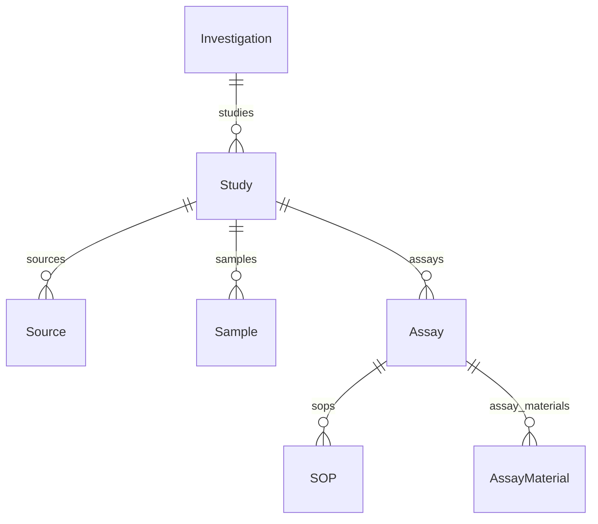

# SEEK-ready template (ISA) v5.0

An ISA-shaped template for a profile whose datasets upload to [FAIRDOM-SEEK](https://seek4science.org/) as ISA-JSON compliant content. Every entity maps to a SEEK/ISA role, and every column SEEK requires is a declared field, so a dataset built on it syncs to SEEK with nothing left behind and nothing added unseen.

Clone it in the Spec Builder, change it only in the ways listed under [What you can change](#what-you-can-change), and keep the rest. For the general rules, see [Authoring a SEEK-ready profile](../guides/seek-ready-profiles.md).

## Structure



- **Investigation**: the project (the root).
- **Study**: one line of work in it. SEEK creates exactly one Source type and one Sample type per Study, from the Source and Sample entities.
- **Source**: what the study starts from: a plant, a biological material, or an existing dataset you reuse, named by its accession.
- **Sample**: something taken from one or more Sources: tissue, an extract, or the part of a reused dataset you work with. Its `Input` names those Sources.
- **Assay**: a measurement or an analysis.
- **AssayMaterial**: what an Assay produced: an extract, a data file, an analysis result. It sits under its Assay, and its `Input` names the Samples it was produced from, one or more.
- **SOP**: a standard operating procedure an Assay follows, registered in SEEK by the location of its document (`url`).

The chain Source, Sample, AssayMaterial is held together by `Input`, not by nesting, which is how SEEK links its sample types. One Sample can come from several Sources, one AssayMaterial from several Samples, and one Sample can feed several Assays.

There is no ObservationUnit level: the SEEK export creates one per Sample.

## What SEEK requires

These fields are hard-coded in SEEK. Renaming, retyping or removing any of them breaks the upload; each one's description says so.

| Entity | SEEK object | A value is required | The field must exist, a value is optional |
| --- | --- | --- | --- |
| Investigation | Investigation | `title`, which identifies the record | `description` |
| Study | Study | `title`, which identifies the record | `description` |
| Assay | Assay | `title`, which identifies the record; `assay_class` (`EXP` or `MODEL`); `assay_type` (a JERM ontology URI) | `description` |
| SOP | SOP | `title`; `url`, the location SEEK registers it by | |
| Source | Source sample type | `source_name`, the title column (ISA tag `source`) | |
| Sample | Sample Collection sample type | `sample_name`, the title column (ISA tag `sample`); `Input`, the Sources it came from (`Registered Sample List`, ISA tag `input`) | `Protocol` (ISA tag `protocol`) |
| AssayMaterial | Assay sample type | `material_name`, the title column (ISA tag `other_material`); `Input`, the Samples it came from (`Registered Sample List`, ISA tag `input`) | `Protocol` (ISA tag `protocol`) |

SEEK has no identifier attribute on an Investigation, Study or Assay, so the title identifies them. A chained sample type must have exactly one protocol column, but a Sample need not fill it. Every column of a sample type carries an ISA tag; a field you add takes its level's characteristic tag unless it declares another.

## What you can change

- **Add fields to Source, Sample and AssayMaterial.** Each becomes a column of that sample type, tagged `source_characteristic`, `sample_characteristic` or `other_material_characteristic`.
- **Add assay types.** Copy AssayMaterial under a new name for each kind of output, with its own fields. Each becomes its own sample type in the Assay's stream.
- **Add fields to Investigation, Study or Assay as Extended Metadata.** SEEK holds them as attributes of an Extended Metadata Type, which an administrator installs on the SEEK instance; the entity names it in `seek.extended_metadata`. Without one installed, mark the field `seek_isa_only`: it then reaches SEEK only inside the ISA-JSON export.
- **Record different kinds of source in the one Source type**, with a field saying which kind. Kinds that need different columns go in separate Studies, because a Study has one Source type.

## Mapping your data onto it

| Your record | Entity | Where it goes |
| --- | --- | --- |
| The project | Investigation | the root |
| One line of work in the project | Study | under the Investigation |
| What the work starts from | Source | under the Study |
| Something taken from Sources | Sample | under the Study, naming its Sources in `Input` |
| A measurement or an analysis | Assay | under the Study |
| What an Assay produced | AssayMaterial | under its Assay, naming its Samples in `Input` |

**Example: reanalysing public data.** A study that combines two ENA datasets in one analysis has a Source per dataset (`source_name` `PRJEB1111` and `PRJEB2222`), a Sample per dataset for the reads used (`Input` naming its Source), and one Assay, *Combined RNA-seq analysis*, with `assay_class` `MODEL`. Its AssayMaterial, the combined count table, names both Samples in `Input`. A second analysis of the first dataset is a second Assay whose AssayMaterial names only the first Sample.

## SEEK's record fields

The Investigation, Study and Assay records carry SEEK's own attributes:

| Entity | Fields sent to SEEK | ISA-JSON only (`seek_isa_only`) |
| --- | --- | --- |
| Investigation | `title`, `description` | `submission_date`, `public_release_date` |
| Study | `title`, `description` | `study_design_type`, `start_date`, `end_date`, `experimental_site`, `country` |
| Assay | `title`, `description`, `assay_class`, `assay_type` | `measurement_type`, `technology_type`, `technology_platform` |

`technology_type` is ISA-only here because it holds free text, while SEEK's attribute of that name takes an ontology URI.

## Versions

| Version | Change |
| --- | --- |
| 5.0 | Breaking: every column SEEK requires is a declared field. Sample and AssayMaterial gain `Input` and `Protocol`, and each level's name field is its ISA title column, so the sync adds no columns of its own. Sample sits under the Study and AssayMaterial under its Assay, linked by `Input` rather than nesting, so one material can come from several samples; `AssayMaterial.assay` is gone. |
| 4.0 | Breaking: no `identifier` field on Investigation, Study and Assay (the title identifies them); Assay gains `description`, `assay_class` and `assay_type`, and its title is required; an Assay lists its SOPs (`sops`, the `SOP` role); `AssayMaterial.assay` names the Assay by title; fields SEEK has no attribute for are marked `seek_isa_only`. |
| 3.0 | Breaking: the material chain Source, Sample, AssayMaterial is explicit. |
| 2.0 | A single Sample level under Assay. |
| 1.0 | Investigation, Study, Sample and Assay. |

## Using it

```python
from metaseed.specs.loader import SpecLoader

spec = SpecLoader().load_profile(version="5.0", profile="seek-ready-template")
print(spec.root_entity)                 # Investigation

# Each entity declares the SEEK role it uploads as.
for name, entity in spec.entities.items():
    print(name, "->", entity.seek.role if entity.seek else None)
```
