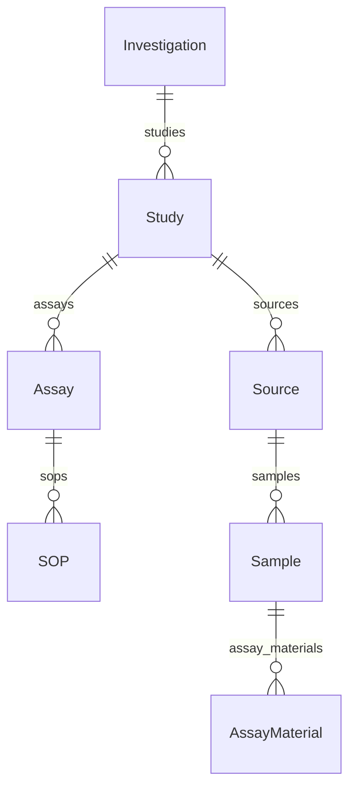

# SEEK-ready template (ISA) v4.0

An ISA-shaped template for a profile whose datasets upload to [FAIRDOM-SEEK](https://seek4science.org/) as ISA-JSON compliant content. Every entity maps to a SEEK/ISA role, so a dataset built on it syncs to SEEK with nothing left behind.

Clone it in the Spec Builder, add your own fields, and keep the shape. For the rules behind it, see [Authoring a SEEK-ready profile](../guides/seek-ready-profiles.md).

## Structure



- **Investigation**: the overarching project (the root).
- **Study**: a study within it.
- **Source**: a source material the study started from, the head of the ISA material chain.
- **Sample**: a sample collected from a Source.
- **AssayMaterial**: a material or data file measured from a Sample. It names the Assay that measured it by that Assay's title (`assay`), because one Assay measures materials from many Samples and containment cannot express that.
- **Assay**: a measurement performed on the materials.
- **SOP**: a standard operating procedure an Assay follows. The SEEK export registers it by the location of its document (`url`) and links it to the Assay.

There is no ObservationUnit level: the SEEK export synthesises one per sample.

## What is fixed and what you can change

| Fixed | Why |
| --- | --- |
| The structure Investigation, Study, Source, Sample, AssayMaterial, with Assays under the Study, and each entity's SEEK role | The sync places each level by its role and position in the chain |
| One Source type and one Sample type per Study | SEEK creates exactly one of each for an ISA study |
| `title` identifies an Investigation, Study or Assay | SEEK has no identifier attribute on these records |
| An Assay's `assay_class` and `assay_type` | SEEK requires both |
| `source_name`, `sample_name`, `material_name` identify their level | Each carries the ISA title tag SEEK validates |
| `AssayMaterial.assay` names an Assay by title | It is how an AssayMaterial links to the Assay that produced it |

Renaming or removing any of these breaks the upload.

You can add fields to any entity, add assay types (each Assay gets its own sample type), and mark Investigation, Study and Assay fields SEEK has no attribute for with `seek_isa_only`. Different kinds of source, such as plants and reused datasets, share the one Source type; a field records the kind. Kinds that need different columns go in separate Studies.

## Mapping your data onto it

| Your record | Entity | Where it goes |
| --- | --- | --- |
| The project | Investigation | the root |
| One line of work in the project | Study | under the Investigation |
| What the work starts from: a plant, a biological sample, or an existing dataset you reuse | Source | under the Study; a reused dataset is named by its accession |
| Something taken from a Source: tissue, an extract, the part of a reused dataset you work with | Sample | under its Source |
| A measurement or an analysis | Assay | under the Study |
| What an Assay produced from a Sample: an extract, a data file, an analysis result | AssayMaterial | under its Sample, naming the Assay by title in `assay` |

An Assay never nests under its inputs. An Assay that uses several Sources or Samples has an AssayMaterial under each of them, all naming it, so one Assay can combine inputs and one input can feed several Assays.

**Example: reanalysing public data.** A study that combines two ENA datasets in one analysis has a Source per dataset (`source_name` `PRJEB1111` and `PRJEB2222`), a Sample under each for the reads used, and one Assay, *Combined RNA-seq analysis*, with `assay_class` `MODEL`. Each Sample holds an AssayMaterial for the analysis output from that dataset, and both name the Assay. A second analysis of the first dataset adds another AssayMaterial under its Sample, naming the second Assay.

## SEEK's record fields

The Investigation, Study and Assay records carry SEEK's own attributes:

| Entity | Fields sent to SEEK | ISA-JSON only (`seek_isa_only`) |
| --- | --- | --- |
| Investigation | `title`, `description` | `submission_date`, `public_release_date` |
| Study | `title`, `description` | `study_design_type`, `start_date`, `end_date`, `experimental_site`, `country` |
| Assay | `title`, `description`, `assay_class`, `assay_type` | `measurement_type`, `technology_type`, `technology_platform` |

SEEK has no identifier attribute on these records, so `title` is the identifier and is required. `assay_class` is `EXP` (experimental) or `MODEL` (modelling) and `assay_type` a JERM ontology URI; SEEK requires both. `technology_type` is ISA-only here because it holds free text, while SEEK's attribute of that name takes an ontology URI. The ISA-only fields reach SEEK inside the ISA-JSON export, not as record attributes.

## Versions

| Version | Change |
| --- | --- |
| 4.0 | Breaking: no `identifier` field on Investigation, Study and Assay (the title identifies them); Assay gains `description`, `assay_class` and `assay_type`, and its title is required; an Assay lists its SOPs (`sops`, the `SOP` role); `AssayMaterial.assay` names the Assay by title; fields SEEK has no attribute for are marked `seek_isa_only`. |
| 3.0 | Breaking: the material chain Source, Sample, AssayMaterial is explicit. |
| 2.0 | A single Sample level under Assay. |
| 1.0 | Investigation, Study, Sample and Assay. |

## Using it

```python
from metaseed.specs.loader import SpecLoader

spec = SpecLoader().load_profile(version="4.0", profile="seek-ready-template")
print(spec.root_entity)                 # Investigation

# Each entity declares the SEEK role it uploads as.
for name, entity in spec.entities.items():
    print(name, "->", entity.seek.role if entity.seek else None)
```
