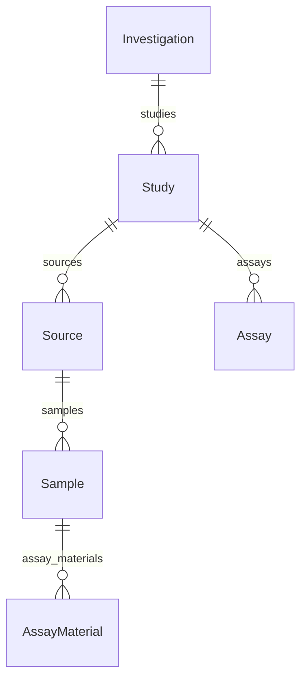

# SEEK-ready template (ISA) v4.0

An ISA-shaped template for a profile whose datasets upload to [FAIRDOM-SEEK](https://seek4science.org/) as ISA-JSON compliant content. Every entity maps to a SEEK/ISA role, so a dataset built on it syncs to SEEK with nothing left behind.

Clone it in the Spec Builder, add your own fields, and keep the shape. For the rules behind it, see [Authoring a SEEK-ready profile](../guides/seek-ready-profiles.md).

## Structure



- **Investigation**: the overarching project (the root).
- **Study**: a study within it.
- **Source**: a source material the study started from, the head of the ISA material chain.
- **Sample**: a sample collected from a Source.
- **AssayMaterial**: a material or data file measured from a Sample. It names the Assay that measured it by that Assay's title (`assay`), because one Assay measures materials from many Samples and containment cannot express that.
- **Assay**: a measurement performed on the materials.

There is no ObservationUnit level: the SEEK export synthesises one per sample.

## SEEK's record fields

The Investigation, Study and Assay records carry SEEK's own attributes:

| Entity | Fields sent to SEEK | ISA-JSON only (`seek_isa_only`) |
| --- | --- | --- |
| Investigation | `title`, `description` | `submission_date`, `public_release_date` |
| Study | `title`, `description` | `study_design_type`, `start_date`, `end_date`, `experimental_site`, `country` |
| Assay | `title`, `description`, `assay_class`, `assay_type` | `measurement_type`, `technology_type`, `technology_platform` |

SEEK has no identifier attribute on these records, so `title` is the identifier and is required. `assay_class` is `EXP` (experimental) or `MODEL` (modelling) and `assay_type` a JERM ontology URI; SEEK requires both. `technology_type` is ISA-only here because it holds free text, while SEEK's attribute of that name takes an ontology URI. The ISA-only fields reach SEEK inside the ISA-JSON export, not as record attributes.

## Versions

| Version | Change |
| --- | --- |
| 4.0 | Breaking: no `identifier` field on Investigation, Study and Assay (the title identifies them); Assay gains `description`, `assay_class` and `assay_type`, and its title is required; `AssayMaterial.assay` names the Assay by title; fields SEEK has no attribute for are marked `seek_isa_only`. |
| 3.0 | Breaking: the material chain Source, Sample, AssayMaterial is explicit. |
| 2.0 | A single Sample level under Assay. |
| 1.0 | Investigation, Study, Sample and Assay. |

## Using it

```python
from metaseed.specs.loader import SpecLoader

spec = SpecLoader().load_profile(version="4.0", profile="seek-ready-template")
print(spec.root_entity)                 # Investigation

# Each entity declares the SEEK role it uploads as.
for name, entity in spec.entities.items():
    print(name, "->", entity.seek.role if entity.seek else None)
```
